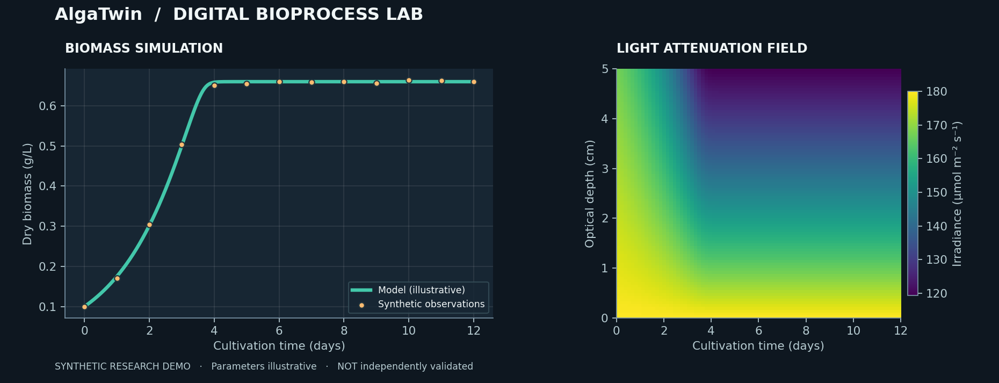

# 🧫 AlgaTwin

**A transparent, interactive microalgal batch photobioreactor simulator and parameter-calibration prototype.**

> **Scientific status: ALPHA.** Model implementation is tested on synthetic cases, but **independent laboratory validation has NOT been established**. Example datasets are synthetic. Do not use as a basis for operating production bioreactors.



*Illustrative simulation and synthetic measurements — not lab-validated.*

## What it does today (v0.4.0)

- Simulates dry biomass and nitrate-as-nitrogen concentration in a **single-species, well-mixed, batch** photobioreactor.
- Baseline workflow uses Monod nitrogen limitation, spatially integrated light saturation, Beer–Lambert-type biomass self-shading and fixed biomass yield.
- Accepts UTF-8 CSV with user-mapped time, biomass and optional nitrate-N columns; checks units/values and plots observations.
- Calibrates **one** growth-rate parameter for biomass-only observations; estimates biomass yield too if at least three nitrogen observations exist. Other parameters remain fixed assumptions.
- Shows biomass and nitrogen curves, a depth-vs-time light heatmap, and stored comparative scenarios with snapshot model parameters.
- **TrustLens:** local finite-difference parameter sensitivity and warnings about leaving the calibration conditions (NOT uncertainty intervals).
- **Planner:** a bounded light × nitrogen grid with sampled Pareto tags; scenario exploration, NOT an experimentally validated optimiser.
- **CLI:** run explicitly synthetic simulations or constrained DEMO-assumption CSV fitting without the web interface.
- Exports CSV predictions and a JSON provenance manifest.
- Includes numerical/scientific tests, GitHub Actions and Docker/Streamlit deployment setup.
- Records value, source, status, species, conditions, mass basis and evidence tier in a provenance table and JSON exports.
- Keeps C. minutissima extinction at None / NO_SPECIES_DATA; no C. pyrenoidosa transfer or assumed carbon fraction.
- Provides a direct extinction-measurement CSV helper with residuals, method and in-sample R²; user estimates stay UNVERIFIED / MEASURED.
- Supports linear and optional sublinear extinction; coefficient units depend on the exponent. No verified species range is invented.

- Provides a separate **Selectable models (SYNTHETIC)** workspace: Monod / Droop N quota,
  saturation / Haldane / steady-state Han light, optional CTMI temperature and half-sine diurnal light.
- Tracks dissolved, stored and removed nitrogen with a common `ModelBase.rhs/params/states`
  interface. New-model fitting/model-support selection is pending.
- Documents and regression-tests the printed arXiv v1 Eq. 9 high-light branch discrepancy;
  the general optical-depth calculation compares both compensation roots and Y=0.

### Parameter tiers and evidence

LITERATURE contains audited source records, not a complete runnable Monod preset. DEMO contains explicitly selected UNVERIFIED assumptions; MEASURED identifies user optical estimates. Source transcription does not establish validation for your strain. Reported Haldane points are not substituted into Monod equations. Verified-range overrides generate warnings when source-reported bounds exist; none were established for the present catalogue. See [source audit](docs/PARAMETER_AUDIT.md) and [model/units](docs/MODEL.md).

### Not built yet

Joint multi-run fitting, profile likelihood/identifiability, dynamic photosystem adaptation, multi-strain consortia, dynamic pH/CO₂, online IoT, formal statistical parameter intervals, independent-laboratory validation, global/continuous optimisation, formal model uncertainty intervals and scientifically supported operational recommendations.

## Quick start

Python 3.11+:

```bash
python -m venv .venv
source .venv/bin/activate            # Windows: .venv\\Scripts\\activate
pip install -r requirements.txt
streamlit run app.py
```

Open http://localhost:8501 . The initial LITERATURE screen shows the C. minutissima catalogue and the direct extinction helper. Missing species parameters remain unset, so research simulation is blocked. Select **DEMO — synthetic assumptions** explicitly to run the simulator. The Workspace selector also opens the new synthetic model sandbox; see [selectable models and Python example](docs/SELECTABLE_MODELS.md). No API keys are required.

### CLI usage

```bash
pip install -e .
alga-twin simulate --demo --days 12 --light 180 --nitrogen 70 --output simulation.csv
alga-twin fit --demo --input data/synthetic_chlorella_demo.csv --light 180 --path-cm 5 --output fitted.json
```

The CLI requires --demo because a complete literature Monod configuration is unavailable. Its fit reports in-sample residual metrics only. Missing explicit parameters in the Python API are rejected; use alga_twin.demo.demo_parameters() deliberately for synthetic examples.

### Docker

```bash
docker build -t alga-twin .
docker run --rm -p 8501:8501 alga-twin
```

### Render hosting (alternative)

[`render.yaml`](render.yaml) provides a Render Blueprint configuration, with no secrets required. A hosting account and explicit deployment are still necessary.

### Streamlit Community Cloud

1. Push repository with `app.py` at the root and `requirements.txt` plus `src/`.
2. Create a new Streamlit app using repository `OWNER/alga-twin`, branch `main`, main file `app.py`.
3. Deploy. The project requires no API keys or secrets. An external Streamlit Cloud account and deployment action are still required.

## CSV format

Use **one batch culture run per file**, with an increasing `time_day` and `biomass_g_L`. Optional `nitrate_n_mg_L` may have gaps:

```csv
time_day,biomass_g_L,nitrate_n_mg_L
0,0.10,70
2,0.20,62
4,0.34,48
6,0.46,31
8,0.53,18
```

Values above are **illustrative**, not empirical measurements. All data must use g dry weight/L and **mg elemental nitrogen/L (nitrate-N, not nitrate ion)**. Biomass proxies such as OD or cell counts require independent calibration to dry weight before use. The app does not estimate this calibration.

- File limit 2 MB, row limit 5,000; at least four observations. CSV column names can be mapped in the sidebar, but values must already use the documented units.
- No duplicate time points; missing biomass/time rejected; missing nitrate values allowed.
- Time is internally shifted to the first observation at day zero.
- Incidence irradiance and optical path during the original experiment must be entered in the sidebar. The first biomass and, when measured, nitrogen value define initial conditions for fitting.
- Fitting currently assumes constant incident light and reactor optical path for the whole batch.

## Mathematics / scientific scope

See [docs/MODEL.md](docs/MODEL.md) for equations, dimensional conventions, calibration restrictions, numerical integration, and current limitations. Assumed parameters in the default model are pedagogical placeholders, **not measured parameters for any specific Chlorella strain**.

## Tests

**v0.4: 100 local tests passed (Python 3.12); Ruff lint/format and compileall passed.** **Cloud Python 3.11/3.12: 100 tests and Ruff passed each.** [Current CI evidence](https://github.com/ysmhla/alga-twin/actions/runs/40197007799) certifies source commit 8bf5527a21491ee6a636bf94f2dcf38e41f0ffee; see [verification record](docs/VERIFICATION.md).
The historical v0.3.0 cloud run passed 62 tests and Ruff on Python 3.11/3.12
([run 40182152435](https://github.com/ysmhla/alga-twin/actions/runs/40182152435)); it does not certify the new model code. Public deployment, visual browser checks, Docker build and independent laboratory validation remain unverified. See [verification record](docs/VERIFICATION.md).

```bash
pip install -r requirements.txt -e '.[dev]'
pytest -q
ruff check src app.py tests
ruff format --check src app.py tests
```

## Project design

```text
app.py                    # Streamlit interactive laboratory
src/alga_twin/model.py    # Retained baseline ODEs/light/solver
src/alga_twin/models.py   # Common interface, Monod/Droop, light/temperature
src/alga_twin/optimum.py  # Compensation roots and boundary optimum
src/alga_twin/data.py     # Strict experimental CSV ingestion
src/alga_twin/fitting.py  # Constrained multi-start fitting
src/alga_twin/demo.py     # Reproducible SYNTHETIC observations
src/alga_twin/reporting.py# Error metrics and provenance
.github/workflows/ci.yml  # Python 3.11/3.12 tests
Dockerfile                # Container deployment
```

See [Architecture](docs/ARCHITECTURE.md), [Release status](docs/RELEASE_STATUS.md), and [Deployment checklist](docs/DEPLOYMENT.md).

## Research roadmap

1. Independent-run evaluation on legally shareable measured data.
2. Local identifiability diagnostics and statistically defensible intervals.
3. Statistically and operationally meaningful light/nutrient optimisation; current grid is exploratory only.
4. Evaluate the selectable models against independently held-out cultivation runs.
5. Research collaboration and reproducible benchmark suites.

## Security and privacy

No authentication, user database or deliberate persistence of uploaded CSV data. Public deployments process inputs on the hosting service; avoid uploading confidential research data unless deployment/privacy requirements have been assessed. Resource limits exist to reduce accidental heavy usage; they are not a formal security audit.

## License and citation

MIT; see [LICENSE](LICENSE) and [CITATION.cff](CITATION.cff). Scientific research credit does not imply validation. Contributions and validation datasets are welcome.
