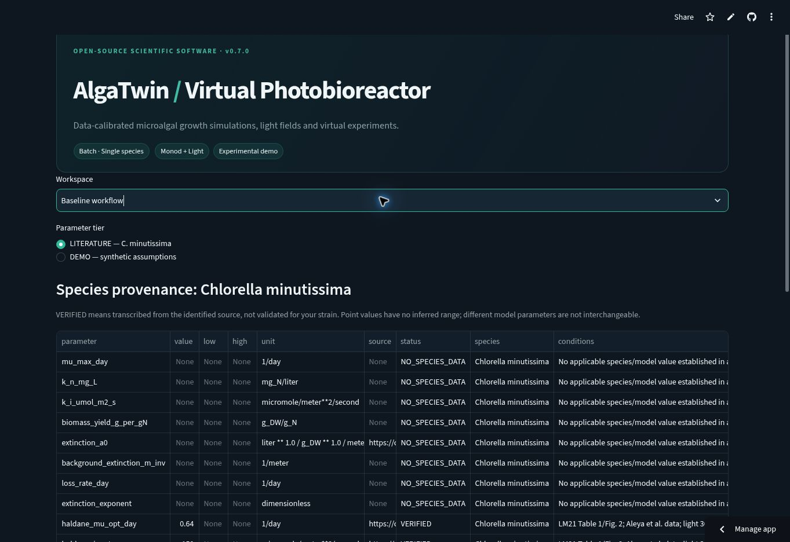
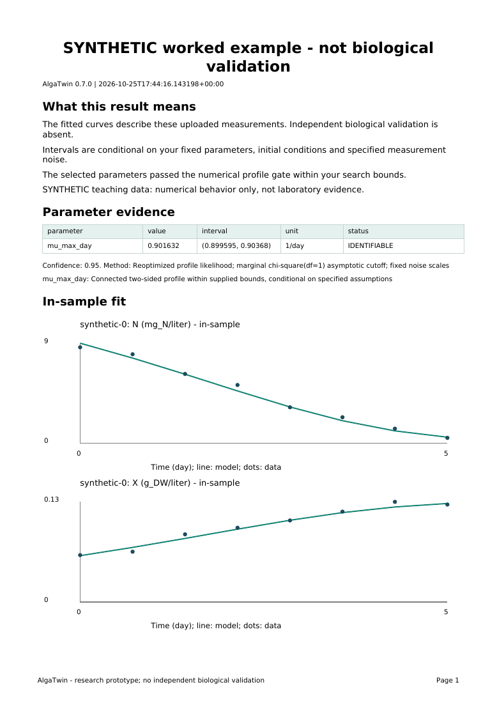

**Development main: 0.8.2.dev0.** The archived stable citation remains v0.8.1, DOI 10.5281/zenodo.23665342. This development snapshot has no separate archive DOI.

# 🧫 AlgaTwin

**A transparent, interactive microalgal batch photobioreactor simulator and parameter-calibration prototype.**

> **Scientific status: ALPHA.** Model implementation is tested on synthetic cases, but **independent laboratory validation has NOT been established**. Example datasets are synthetic. Do not use as a basis for operating production bioreactors.

**[Open the public demo](https://alga-twin.streamlit.app/)** · **[Documentation site](https://ysmhla.github.io/alga-twin/)** · Python 3.12.
Start with **Workspace -> Guided upload to report -> SYNTHETIC worked example**
for the labelled teaching path. Real strain inputs require your own evidence.



*Actual hosted app, initial v0.7.0 smoke capture. Missing species parameters remain
unset. No independent biological validation.*

## What it does today (v0.8.1)

- Simulates dry biomass and nitrate-as-nitrogen concentration in a **single-species, well-mixed, batch** photobioreactor.
- Baseline workflow uses Monod nitrogen limitation, spatially integrated light saturation, Beer–Lambert-type biomass self-shading and fixed biomass yield.
- Accepts UTF-8 CSV with user-mapped time, biomass and optional nitrate-N columns; checks units/values and plots observations.
- The baseline fitter estimates growth-rate and optionally yield, then reoptimizes profiles. It withholds unsupported point estimates/intervals; other parameters remain fixed assumptions.
- Shows biomass and nitrogen curves, a depth-vs-time light heatmap, and stored comparative scenarios with snapshot model parameters.
- **TrustLens:** local finite-difference parameter sensitivity and warnings about leaving the calibration conditions (NOT uncertainty intervals).
- **Planner:** a bounded light × nitrogen grid with sampled Pareto tags; scenario exploration, NOT an experimentally validated optimiser.
- **CLI:** run explicitly synthetic simulations or constrained DEMO-assumption CSV fitting without the web interface.
- Exports CSV predictions and a JSON provenance manifest.
- Includes numerical/scientific tests, GitHub Actions and Docker/Streamlit deployment setup.
- Records value, source, status, species, conditions, mass basis and evidence tier in a provenance table and JSON exports.
- Keeps C. minutissima extinction at None / NO_SPECIES_DATA; no C. pyrenoidosa transfer or assumed carbon fraction.
- Provides a direct extinction-measurement CSV helper with residuals, method and in-sample R²; user estimates stay UNVERIFIED / MEASURED.
- Supports linear and optional sublinear extinction; coefficient units depend on the exponent. No verified species range is invented.

- Provides a separate **Selectable models (SYNTHETIC)** workspace: Monod / Droop N quota,
  saturation / Haldane / steady-state Han light, optional CTMI temperature and half-sine diurnal light.
- Tracks dissolved, stored and removed nitrogen with a common `ModelBase.rhs/params/states`
  interface. A separate joint calibration workspace/API fits selected shared parameters; conditional supported model selection is available separately.
- Documents and regression-tests the printed arXiv v1 Eq. 9 high-light branch discrepancy;
  the general optical-depth calculation compares both compensation roots and Y=0.

- Fits shared parameters across multiple light/N runs with additive or log-normal errors and explicit noise SDs/search bounds.
- Preserves technical replicates, computes nuisance-reoptimized profile likelihoods and named conditional marginal intervals.
- Labels flat/open/unsupported profiles **NOT IDENTIFIABLE** and refuses their point estimates.
- Refits/reprofiles whole-run holdouts and exports **in-sample vs held-out** metrics separately.
- Provides a paired JSON-job/long-CSV loader and `fit-joint` CLI; see [calibration methods/limitations](docs/CALIBRATION.md).

- Provides a `benchmark/` registry, metadata/licence/units/hash checks and an explicitly SYNTHETIC fixture.
- Exports **PEtab 2 native-model** problems and checks them using libpetab; the explicit AlgaTwin reader is required.
- Runs actual **pyPESTO profiles** as a full-data cross-check, alongside native profile-gated whole-run CV, and writes a licence-bearing scoreboard.
- Keeps in-sample/held-out errors separate and refuses held-out aggregation when folds fail. See [benchmark instructions and compatibility limits](benchmark/README.md) and [actual synthetic scoreboard](benchmark/scoreboard.md).

- Provides a **Guided upload to report** workspace: explicit column/unit mapping, model/assumption entry, profile-gated fit and HTML/PDF/JSON reports.
- Fits paired **OD/cell-count -> dry weight** linear/quadratic conversions with residuals/in-sample R² and refuses extrapolation. User conversion uncertainty is not propagated into growth intervals.
- Keeps research/unknown-strain biological fields blank when evidence is missing; no executable VERIFIED-range C. minutissima preset is available.
- Includes [two executed SYNTHETIC tutorials](tutorials/README.md), [worked report](tutorials/output/synthetic_report.pdf), and a [guided workflow guide](docs/GUIDED_WORKFLOW.md). Public hosting and actual app screenshots are verified in the [browser smoke record](docs/smoke/README.md); actual novice timing/observed human usability remain pending.

- **Model support and next experiment** compares identical-data Monod/Droop/light models using AIC/BIC, conditional profiles and an explicitly approximate residual screen. It can report no supportable model.
- Ranks supplied feasible next experiments by local expected Fisher information and shows top three with reasons. Local SD/volume reductions are not confidence intervals or biological guarantees. See [methods, explicit inputs and limits](docs/DECISION_SUPPORT.md).

### Parameter tiers and evidence



*Generated PDF preview, not an app screenshot. Actual hosted screenshots are in the browser smoke record; observed novice usability remains pending.*

LITERATURE contains audited source records, not a complete runnable Monod preset. DEMO contains explicitly selected UNVERIFIED assumptions; MEASURED identifies user optical estimates. Source transcription does not establish validation for your strain. Reported Haldane points are not substituted into Monod equations. Verified-range overrides generate warnings when source-reported bounds exist; none were established for the present catalogue. See [source audit](docs/PARAMETER_AUDIT.md) and [model/units](docs/MODEL.md).

### Not built yet

Optional MCMC, censoring/detection-limit errors, empirical interval coverage, random culture effects, dynamic photosystem adaptation, multi-strain consortia, dynamic pH/CO₂, online IoT, independent-laboratory validation, global/continuous optimisation, prediction uncertainty intervals and scientifically supported operational recommendations.

## Quick start

Python 3.11+:

```bash
python -m venv .venv
source .venv/bin/activate            # Windows: .venv\\Scripts\\activate
pip install -r requirements.txt
streamlit run app.py
```

Open http://localhost:8501 . The Workspace selector opens **Guided upload to report** and **OD / cell count calibration** directly. The initial baseline LITERATURE screen shows the C. minutissima catalogue and the direct extinction helper. Missing species parameters remain unset, so research simulation is blocked. Select **DEMO — synthetic assumptions** explicitly to run the simulator. The Workspace selector also opens the new synthetic model sandbox; see [selectable models and Python example](docs/SELECTABLE_MODELS.md). No API keys are required.

### CLI usage

```bash
pip install -e .
alga-twin simulate --demo --days 12 --light 180 --nitrogen 70 --output simulation.csv
alga-twin fit --demo --input data/synthetic_chlorella_demo.csv --light 180 --path-cm 5 --output fitted.json
```

The baseline simulate/fit CLI requires --demo because a complete literature Monod configuration is unavailable. Its single-run fit reports conditional profiles/intervals and in-sample residual metrics. The `fit-joint` command uses a complete explicit JSON configuration and optionally whole-run holdouts; it supplies no biological defaults. Missing explicit parameters in the Python API are rejected; use alga_twin.demo.demo_parameters() deliberately for synthetic examples.

### Docker

```bash
docker build -t alga-twin .
docker run --rm -p 8501:8501 alga-twin
```

### Render hosting (alternative)

[`render.yaml`](render.yaml) provides a Render Blueprint configuration, with no secrets required. A hosting account and explicit deployment are still necessary.

### Streamlit Community Cloud

1. Push repository with `app.py` at the root and `requirements.txt` plus `src/`.
2. Create a new Streamlit app using repository `OWNER/alga-twin`, branch `main`, main file `app.py`.
3. Deploy. The project requires no API keys or secrets. An external Streamlit Cloud account and deployment action are still required.

## CSV format

Use **one batch culture run per file**, with an increasing `time_day` and `biomass_g_L`. Optional `nitrate_n_mg_L` may have gaps:

```csv
time_day,biomass_g_L,nitrate_n_mg_L
0,0.10,70
2,0.20,62
4,0.34,48
6,0.46,31
8,0.53,18
```

Values above are **illustrative**, not empirical measurements. All data must use g dry weight/L and **mg elemental nitrogen/L (nitrate-N, not nitrate ion)**. Biomass proxies such as OD or cell counts require independent calibration to dry weight before use. Use the paired-measurement **OD / cell count calibration** workspace to estimate this conversion within its measured domain. See [guided workflow](docs/GUIDED_WORKFLOW.md); the baseline CSV route below still requires preconverted DW.

- File limit 2 MB, row limit 5,000; at least four observations. CSV column names can be mapped in the sidebar, but values must already use the documented units.
- No duplicate time points; missing biomass/time rejected; missing nitrate values allowed.
- Time is internally shifted to the first observation at day zero.
- Incidence irradiance and optical path during the original experiment must be entered in the sidebar. The first biomass and, when measured, nitrogen value define initial conditions for fitting.
- Fitting currently assumes constant incident light and reactor optical path for the whole batch.

## Mathematics / scientific scope

See [docs/MODEL.md](docs/MODEL.md) for equations, dimensional conventions, calibration restrictions, numerical integration, and current limitations. Assumed parameters in the default model are pedagogical placeholders, **not measured parameters for any specific Chlorella strain**.

## Packaging and publication

**[v0.8.1 GitHub pre-release](https://github.com/ysmhla/alga-twin/releases/tag/v0.8.1) is published**, with checked wheel/source archives, installed-wheel evidence and a SHA-256 manifest. The release is ALPHA; no independent biological validation.

### Build preparation

Build a wheel/source archive with `python -m build`; check with
`python -m twine check --strict dist/*.whl dist/*.tar.gz`. The wheel provides the
API/CLI; the source archive also includes the dashboard, tutorials, benchmark and docs.
A separate installed-wheel check exercises the actual CLI and Monod/Droop nitrogen ledger.
Use `mkdocs build --strict` for the documentation site. See [publication status](docs/PUBLICATION.md),
[JOSS-style draft](paper.md) and [related work — HUMAN REVIEW PENDING](docs/RELATED_WORK.md).
The [v0.8.1 Zenodo software archive](https://zenodo.org/records/23665342) is published under MIT: version DOI **10.5281/zenodo.23665342**. No PyPI upload or journal acceptance is established.

## Tests

**Unreleased usability patch:** [final-source cloud CI](https://github.com/ysmhla/alga-twin/actions/runs/40342968193)
passed Python 3.12 160 tests/Ruff and both notebooks; Python 3.11 149 tests/one
optional skip/Ruff. Source: c3bbf121d4ea923fa0073d027f69a059afbc108c.
160 local tests passed (287.20 s); Ruff
lint/format, strict docs, citation schema and separate development distribution/
Twine checks passed. Agent/source findings are recorded in
[usability evidence](docs/USABILITY.md); human novice acceptance remains NOT TESTED. The [actual CSV-to-report agent
rehearsal](docs/smoke/v0_8_2_dev/README.md) records 3/3 synthetic holdouts and
parsed reports, with its exact source and 192.868-second timing boundary.

**Post-archive update:** 156 tests passed locally (256.23 s); repository-wide
Ruff lint/format, citation schema and strict docs checks passed. Both formatted
tutorials executed with the explicit in-process runner. See
[the verification record](docs/VERIFICATION.md) for method and limitations.

**v0.8.1 verified source:** 156 local tests passed (626.97 s). Cloud Python 3.12
passed 156 tests/Ruff and both real-kernel tutorials; Python 3.11 passed 145 tests,
one optional PEtab skip and Ruff. [Scientific CI 40290016419](https://github.com/ysmhla/alga-twin/actions/runs/40290016419)
certifies 2b303b502f9c7236c7cdfa6961d83ee6279c4979. [Distribution CI](https://github.com/ysmhla/alga-twin/actions/runs/40290016328)
passed citation/build/Twine and actual installed-wheel/CLI/N-ledger checks on both
Python versions. [Strict docs build](https://github.com/ysmhla/alga-twin/actions/runs/40290016434)
passed. Hosted v0.8.1 model comparison/top-three ranking and actual JSON downloads were checked;
the public docs site is live. [Current browser record](docs/smoke/v0_8_1/README.md).
These SYNTHETIC checks are not biological validation.
See [VERIFICATION.md](docs/VERIFICATION.md) for the initial metadata failure and
cached-import regression. No model RHS, likelihood or biological default changed.

**v0.8.0 local verification:** 155 tests passed (215.24 s), plus Ruff lint/format,
compilation and dependency checks. Cloud run [40244015427](https://github.com/ysmhla/alga-twin/actions/runs/40244015427)
passed 155 tests/Ruff and both tutorials on Python 3.12, and 144 tests/one optional skip/Ruff
on Python 3.11. Exact source: af118784d1bf8bba824f8a2ab7f81faf1edd3e8c.
The initial rollout needed the v0.8.1 cached-import fix; current browser evidence is above. See [decision methods](docs/DECISION_SUPPORT.md)
and [generated synthetic example](docs/decision_example/README.md).

**v0.7.1: cloud Python 3.12 passed 143 tests/Ruff and both real-kernel tutorial
notebooks; Python 3.11 passed 132 tests, one optional PEtab skip and Ruff.**
[CI run 40240500191](https://github.com/ysmhla/alga-twin/actions/runs/40240500191)
certifies source 3b69d4a56059b8b207f3b8e0f13010ada78f2074. Local targeted UI checks,
Ruff lint/format, compilation and dependency checks passed. Public deployment,
actual screenshots and SYNTHETIC downloaded reports are documented in
[the browser smoke record](docs/smoke/README.md). Human novice timing/five
observed human issues remain **NOT TESTED**.

**Prior v0.7.0: 143 tests passed locally (Python 3.12, full optional benchmark toolchain),
plus Ruff lint/format, compilation and dependency checks.** Both SYNTHETIC tutorial
notebooks were executed in-process with IPython; actual fit/CV/report outputs
are included. Cloud Python 3.12 passed 143 tests/Ruff and executed both notebooks with a real
Jupyter kernel; Python 3.11 passed 132 tests, 1 optional benchmark skip and Ruff.
[CI run 40222521288](https://github.com/ysmhla/alga-twin/actions/runs/40222521288)
certifies source edc3ffc4ecaa95a0628f6a0a27d58d6018945ea2. See
[VERIFICATION.md](docs/VERIFICATION.md). PEtab 0.9 benchmarks require
Python 3.12+; app/core CLI support Python 3.11. Public hosting and app browser screenshots are recorded in [the smoke test](docs/smoke/README.md). Timed novice usability remains pending; [five engineering
findings/fixes](docs/USABILITY.md) are not a human study. No measured data or
independent biological validation is present.

```bash
# Full benchmark checks require Python 3.12+:
pip install -r requirements.txt -e '.[dev,benchmark]'
pytest -q
ruff check src app.py tests benchmark tutorials/execute_tutorials.py
ruff format --check src app.py tests benchmark tutorials/execute_tutorials.py
```

## Project design

```text
app.py                    # Streamlit interactive laboratory
src/alga_twin/model.py    # Retained baseline ODEs/light/solver
src/alga_twin/models.py   # Common interface, Monod/Droop, light/temperature
src/alga_twin/optimum.py  # Compensation roots and boundary optimum
src/alga_twin/data.py     # Strict experimental CSV ingestion
src/alga_twin/fitting.py  # Constrained multi-start fitting
src/alga_twin/demo.py     # Reproducible SYNTHETIC observations
src/alga_twin/reporting.py# Error metrics and provenance
.github/workflows/ci.yml  # Python 3.11/3.12 tests
Dockerfile                # Container deployment
```

See [Architecture](docs/ARCHITECTURE.md), [Release status](docs/RELEASE_STATUS.md), and [Deployment checklist](docs/DEPLOYMENT.md).

## Research roadmap

1. Independent-run evaluation on legally shareable measured data.
2. Empirical coverage assessment and broader profile robustness on licensed benchmark problems.
3. Statistically and operationally meaningful light/nutrient optimisation; current grid is exploratory only.
4. Evaluate the selectable models against independently held-out cultivation runs.
5. Licensed measured candidate datasets and independent-run biological evaluation.

## Security and privacy

No authentication, user database or deliberate persistence of uploaded CSV data. Public deployments process inputs on the hosting service; avoid uploading confidential research data unless deployment/privacy requirements have been assessed. Resource limits exist to reduce accidental heavy usage; they are not a formal security audit.

## License and citation

MIT; see [LICENSE](LICENSE) and [CITATION.cff](CITATION.cff). Scientific research credit does not imply validation. Contributions and validation datasets are welcome.
